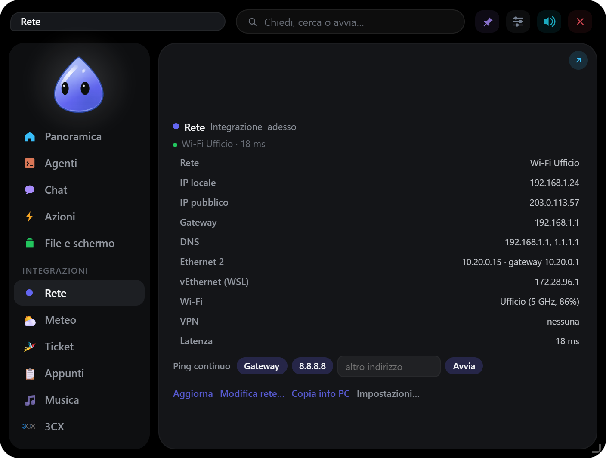
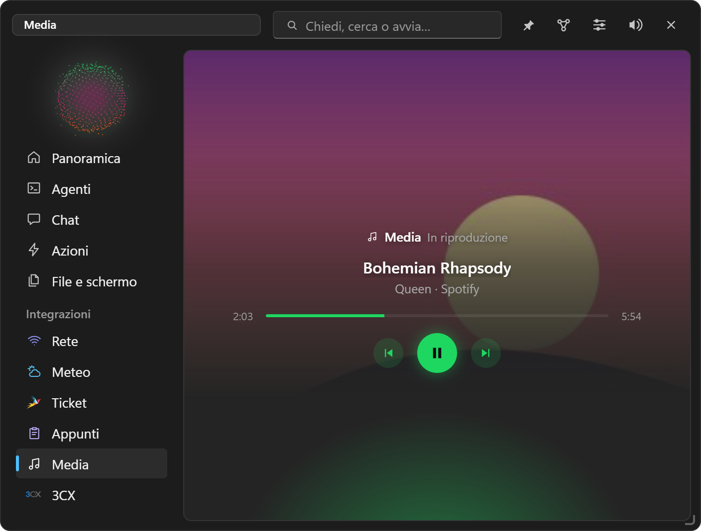
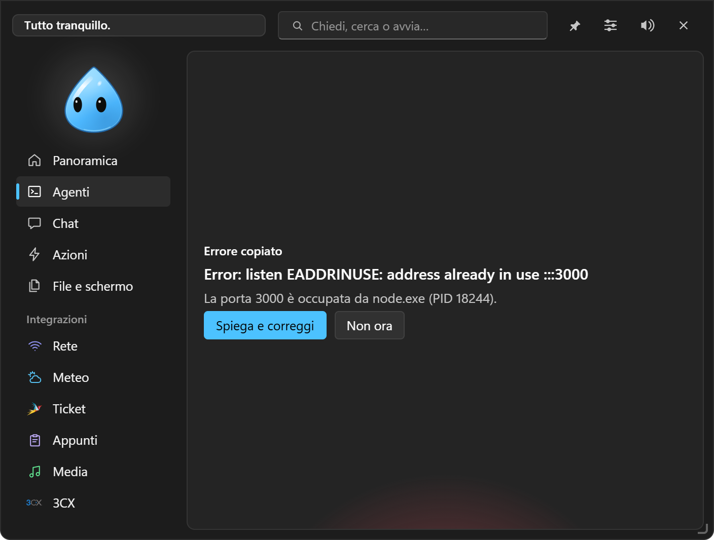
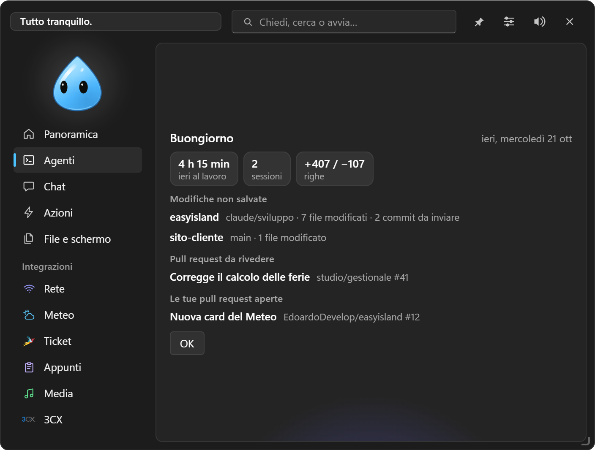
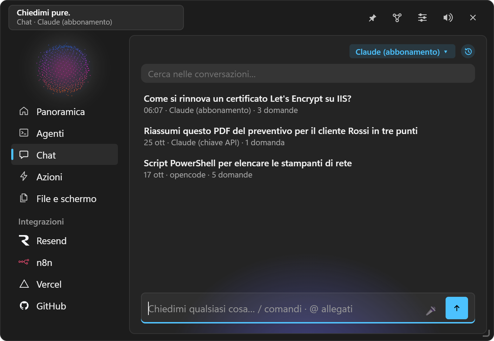

# Versioni di EasyIsland

Cosa è cambiato in ogni versione, dalla più recente. Il riassunto delle ultime sta nel [README](README.it.md#ultime-versioni).

**1.0.14** — **Notizie** (Impostazioni → Notizie): EasyIsland propone gli argomenti di cui parla la tua
memoria (mai persone e clienti) e, per quelli che segui, cerca su Google News ogni 4 ore, nella lingua
dell'app, filtrando sul PC le parole da evitare, le notizie già viste e la stessa storia ripresa da
altri giornali. Le trovi nella voce **Notizie** dell'isola, in un riquadro in fondo alla Panoramica, nel
Buongiorno del mattino, su Telegram con `/notizie` e come elemento della barra fissa. Su ogni notizia
**Di più** (più notizie sull'argomento e subito altre sulla stessa storia), **Salva** nella memoria e
**Non mi interessa**: dopo qualche «non mi interessa» l'isola chiede se smettere di seguire l'argomento.
Corretto: «L'isola si apre» era nascosta e ignorata con la barra fissa; ora vale anche lì. Nella guida
il pulsante della lingua porta sempre alla pagina giusta.

**1.0.13** — **Widget della barra** (Impostazioni → Aspetto → Barra fissa): «+ Aggiungi» apre un catalogo
per gruppi con orologio e data, volume, microfono, luminosità, batteria, velocità della rete e menu di
spegnimento, oltre a integrazioni, widget, striscia e azioni rapide; gli elementi di sistema si possono
aggiungere più volte (due orologi con fusi diversi). In «Opzioni» scegli il formato con i segnaposto, un
secondo testo che compare con un clic, il suggerimento e cosa fanno clic, clic centrale, clic destro e
rotella. Un clic apre la **card nell'isola**, subito sotto la barra: il calendario del mese con gli altri
fusi e i prossimi appuntamenti, i cursori di volume, microfono e luminosità, batteria e rete. Il menu di
spegnimento chiede sempre conferma prima di sospendere, riavviare o spegnere. Coucou non è più citato.

**1.0.12** — La **barra fissa** torna al suo posto da sola quando spegni e riaccendi il monitor, lo cambi
o cambi risoluzione o scala: prima restava della misura vecchia o staccata dal bordo e bisognava
spegnerla e riaccenderla. Vale anche quando Explorer si riavvia.

**1.0.11** — **Barra fissa** (Impostazioni → Aspetto → Barra fissa): una fascia in alto o in basso che
Windows tiene libera come la barra delle applicazioni, con il personaggio all'inizio, al centro o alla
fine, le integrazioni, i widget, le azioni rapide e la striscia dei permessi scelti da te, «…» per ciò
che non ci sta, sfondo come l'isola, trasparente o a colore e **altezza** a scelta (personaggio, icone e
testi si adattano); un clic apre l'isola subito sotto. Il **personaggio vive in una finestra sua**: a
riposo si muove sempre con animazioni leggere e compare con una dissolvenza; a isola aperta resta solo
quello nel menu. La pagina **Aspetto** è divisa in sei **schede** (Tema, Personaggio, Posizione, Barra
fissa, Isola chiusa, Isola aperta) e accanto a ogni voce c'è una **miniatura** dell'isola che mostra cosa
cambia; in Personaggio il personaggio scelto si muove, in Posizione l'angolo si sceglie anche con un clic.
Corretto: «Aggancia ai bordi» spento non aveva effetto in alto al centro.

**1.0.10** — **Rinominare le conversazioni** della cronologia della chat: ✎ accanto a 📌, o doppio clic
sul titolo; Invio salva, Esc annulla, un titolo vuoto torna alla prima domanda. La ricerca nella
cronologia trova anche il titolo nuovo.

**1.0.9** — **Anteprima**: file e pagine web in un browser vero, **dentro l'isola** in un pannello a
destra della chat (largo quanto trascini il bordo, chiuso e riaperto dal pulsante della chat) o in una
finestra separata, a scelta in Impostazioni → Chat; zoom **Adatta / 100% / Originale**, misure da
telefono e tablet, chiaro e scuro, console e modifiche dei file evidenziate. La chat **vede la pagina**
(elementi con un riferimento), clicca e scrive con Consenti / Nega, aspetta che la pagina sia pronta e
legge le richieste fallite. I **passi della chat** dicono a parole cosa sta facendo, anche su Telegram.
I **permessi della chat** compaiono dentro la conversazione con Nega / Sempre / Consenti, anche con
«Permessi e chiamate» spento. Memoria: riassunti e alias delle pagine e una ricerca che segue i legami
forti. Il README e la homepage sono prima in inglese (italiano in `README.it.md` e `/it/`). Corretto:
con l'Anteprima aperta l'isola non si ridimensionava più e l'angolo non seguiva il mouse.

**1.0.8** — **Logo nuovo**: un fumetto con il bordo ad arcobaleno, l'interno scuro e due occhi
bianchi, leggibile anche a 16 px; lo stesso disegno fa da logo nell'isola. **Jarvis Sfera** è il personaggio predefinito
di una nuova installazione. README con indice e schermate nuove; la storia delle versioni sta in
[CHANGELOG.md](CHANGELOG.md).

**1.0.7** — **Flussi**: le automazioni diventano flussi e si costruiscono in una finestra dedicata
(Impostazioni → Flussi → Modifica): il flusso dall'alto in basso, blocchi da **trascinare** o da aggiungere
con il «+», un pannello con i dati da inserire con un clic, modelli pronti e «Descrivilo a parole» (lo
prepara la chat). Blocchi nuovi: **Agente** (lavora con gli strumenti di EasyIsland e il flusso ne aspetta
il risultato, anche con risposte in campi), **Scelta** con regole o decisa dal modello, **Per ogni**
elemento di un elenco, **Domanda** anche su Telegram. Ogni passo può **riprovare** e avere una strada in
caso di errore; un riavvio a metà non rifà le azioni già fatte; **Esecuzioni** con l'esito di ogni passo e
«Riprendi da qui». Pagina unica **Flussi** con i compiti. La Memoria e i Flussi aperti dalle Impostazioni
ora vengono davanti. README e sito presentano EasyIsland come agente personale.

**1.0.6** — **Modalità chiara, scura o automatica** per entrambi gli stili (Impostazioni → Aspetto →
Tema), anche per la finestra delle Impostazioni; Automatica segue Windows. Pagina **Aspetto** riordinata
in cinque sezioni (Tema, Personaggio, Posizione, Isola chiusa, Isola aperta). **Jarvis Plasma**: un globo
al plasma blu e viola, con filamenti che cambiano di continuo; Jarvis Sfera con colori più accesi.
**Memoria**: un **motore per la memoria** a scelta, anche gratuito, crea da solo le pagine degli
argomenti e le relazioni (solo aggiunte, pulsante «Collega con l'IA» e dopo il riordino serale), un
grafo più collegato e il **Grafo 3D** da girare col mouse.

**1.0.5** — **Jarvis**: nuovo personaggio, l'interfaccia di un assistente con un nucleo luminoso e
anelli sempre in movimento, ritmo e colori per ogni stato, un satellite per ogni agente al lavoro e i
secondi sull'anello esterno. **Jarvis Sfera**: la stessa idea come sfera di punti che ondeggia come un
suono. Con Jarvis il meteo è un segno piccolo nell'angolo. Corretto: chiudere l'isola dall'anteprima
nella barra delle applicazioni la faceva sparire finché non si riavviava EasyIsland.

**1.0.4** — **Raccolta**: selezioni del testo in qualsiasi app (anche nome e prezzo sul sito di un
fornitore) e con `Ctrl+Alt+Shift+R` finisce in «File e schermo» con la sua fonte, pagina compresa da
Chrome ed Edge; anche una zona dello schermo da Riquadra e chiedi. Le dai un nome e i campi da ricavare,
e «Chiedi alla chat» passa tutto insieme. **Mappa della memoria** a un clic dall'isola. Corretto: la
mappa diceva «memoria vuota» e la Mappa concettuale si fermava con certe pagine.

**1.0.3** — **Logo o meteo al posto del personaggio** (Impostazioni → Aspetto → «Nell'isola»): il
logo di EasyIsland, il tuo PNG o il meteo, come immagini ferme senza animazioni. **Oltre 150 icone**
per le azioni rapide e **icona automatica**: la favicon del sito per un link, l'icona del programma
per un programma. **Riquadra e chiedi** al posto di Cerchia e chiedi: si trascina un riquadro. Un file
trascinato sull'isola a riposo la apre. Corretto: le Impostazioni saltavano in alto cambiando una
select o un interruttore; l'alone colorato in basso non si vedeva con il tema Windows 11.

**1.0.2** — **L'isola come un'app** (Impostazioni → Isola): aperta ha l'icona nella barra delle
applicazioni e in Alt+Tab, con riduci a icona e schermo intero; chiusa sparisce, e si apre dall'icona
fissata, che col tasto destro offre le azioni rapide. **Resta aperta** quando la apri tu. Testo
dell'isola aperta più grande. **Cartella di lavoro** in griglia o elenco, per nome o data, con icone per
tipo di file e **anteprime delle immagini** (anche nel Vassoio). **Backup completo** con memoria, chat,
compiti e abilità. Telegram uguale in ogni profilo; le Impostazioni si aprono su Generale e non saltano
in alto. Corretto: l'isola dietro una finestra tornava sopra passandoci col mouse.

**1.0.1** — **Telegram anche a PC spento**: i messaggi scritti al bot mentre EasyIsland era spento
si elaborano alla riaccensione, in ordine, sapendo quando li hai scritti. **L'isola passa dietro** le
finestre che le vengono sopra (come la scelta della cartella di lavoro) senza chiudersi, e torna
davanti con un clic o quando serve. **Automazioni più complete**: passi «Aspetta» e «Chiedi prima di
continuare», stop dopo un errore, e dalle abitudini solo routine intere (inizio giornata con profilo,
programmi e punto della giornata), mai «apro un programma a un'ora».

**1.0.0** — **Secondo cervello e guida.** La memoria ha **pagine collegate** su clienti, persone,
progetti e concetti (`[[Titolo]]`, con le relazioni), una cartella **da-leggere** da cui l'agente
impara e scrive le pagine con la fonte, un **controllo** che propone come sistemarla (archivia, non
cancella) e scritture sicure che non toccano ciò che hai cambiato a mano. La **finestra Memoria**
(Impostazioni → Chat → Memoria → Mappa) la mostra come **grafo**, **mappa mentale**, **mappa
concettuale** e **timeline**, con ricerca e file trascinabili. Le **integrazioni personali** si
creano a parole in chat: moduli con formule, documenti, cruscotti di dati letti dai tuoi servizi
con avvisi, chiamate alle loro API con chiavi in Gestione credenziali. E una **[guida
completa](https://edoardodevelop.github.io/easyisland/guida/)** sul sito, linkata in fondo al
menu delle Impostazioni.

**0.9.9** — **EasyIsland diventa un agente**. **Compiti**: gli dai un obiettivo e lo porta avanti
da solo con un piano, i passi e il risultato, subito, a un'ora, ogni giorno, ogni settimana o ogni
N minuti; lo vedi lavorare nella scheda Agenti e ti chiede quando serve. Ogni compito ha il suo
motore e può farsi aiutare da altri motori. **Abilità**: procedure tue in file .md che la chat e i
compiti seguono quando servono, anche come comandi `/nome`. **Battito**: un controllo periodico di
ciò che scrivi in `BATTITO.md`, che ti avvisa solo se c'è qualcosa. **Riordino della memoria** ogni
sera, con le note che approvi tu. Permessi e domande dei compiti anche su Telegram.

**0.9.8** — **Aspetto Windows 11**, ora predefinito: isola e Impostazioni grigie come le finestre
di Windows, con il colore d'accento che hai scelto in Windows, interruttori, campi e pulsanti
come quelli del sistema, icone a linea al posto delle emoji e ogni impostazione su una riga con la
spiegazione sotto. I loghi grandi nei riquadri della Panoramica e i colori delle integrazioni
restano. L'aspetto di prima c'è ancora: Impostazioni → Aspetto → Tema → Stile → Classico.

**0.9.7** — **Chat più comoda**: campo su più righe che non perde la bozza, file incollati o
trascinati a conversazione avviata, Copia / Modifica / ↻ Rigenera / ⑂ Dirama sotto i messaggi,
comandi con `/` (anche le tue azioni rapide), menu `@` per allegare appunti, una finestra o un file
del Vassoio, modelli con `{{campi}}`, **Assistenti** con motore e istruzioni, 🎤 dettatura, cronologia
con ricerca e 📌, Esporta in Markdown, Istruzioni per profilo e `/riprendi` su Telegram. **Memoria**
in file .md: note che la chat ricorda in ogni conversazione e diario giorno per giorno, senza
consumare token. WebView2 usa molto meno RAM con l'isola ritirata.

**0.9.6** — **Accesso remoto**: un collegamento al volo al PC di un cliente con WinRM o SSH
(Windows e Linux), senza salvare niente; con 🔌 la chat ci lavora, ogni comando con Consenti /
Nega; guida passo passo per preparare il PC e pulizia alla chiusura. Le righe di **Notion** si
eliminano anche dalla chat, dopo il tuo sì (finiscono nel cestino di Notion).

**0.9.5** — **Hook in ogni shell**: senza Git Bash, Claude Code esegue gli hook con
PowerShell e il comando di prima lo fermava a ogni strumento; ora va in Git Bash, PowerShell e cmd
(Impostazioni → Agenti → Aggiorna). **Microsoft To Do** dalla chat, tramite Outlook classico:
leggere, aggiungere, cambiare e segnare fatte le attività. L'**isola aperta** si porta su un altro
schermo e ci resta.

**0.9.4** — **Chat più veloce**: Claude Code resta acceso tra i messaggi della stessa
conversazione; le righe di Notion arrivano in una tabella compatta con le categorie per nome e i
totali già fatti; la chat impara **ricette** con l'uso e alle domande simili va dritta agli
strumenti giusti (Impostazioni → Chat → Ricette). Mentre lavora mostra anche il suo ragionamento,
nell'isola e su Telegram. «Quanto ho speso a ottobre»: da 29 a 12 secondi.

**0.9.3** — **Notion per tutti i motori**: la chat legge e aggiunge righe con il collegamento
di EasyIsland, che controlla i valori prima di scrivere (niente più pagine vuote). Gli
**strumenti di EasyIsland** arrivano anche ad **Antigravity** e a **Claude con chiave API**.
**⇄ Seconda opinione**: un altro motore rivede l'ultima risposta, nell'isola e su Telegram.
**/oggi** e **/domani** su Telegram: il punto della giornata.

**0.9.2** — **Ferma** nella chat e su Telegram (■ al posto di Invia, ⏹ Ferma e /stop): la
risposta si interrompe e il motore si chiude. **Mappa di Notion per la chat**: la struttura del
tuo Notion resta sul PC, cifrata, e la chat non deve più cercarla a ogni conversazione.

**0.9.1** — **Remote Desktop Manager con Devolutions Hub**: l'elenco legge anche il
vault utente (prima restava vuoto) e apre la connessione nel suo vault. L'elenco resta
su questo PC, cifrato per il tuo utente Windows, e si aggiorna solo con **Sincronizza**:
RDM non va avviato quando non serve; un pallino dice se è aperto.

**0.9.0** — **Antigravity** di Google come Claude Code e opencode: le sue sessioni
(CLI `agy`, IDE e app) nell'isola con passi, diff e **Consenti / Nega** su comandi e
strumenti MCP, e come **motore della chat** con i suoi strumenti, anche da Telegram;
le istruzioni di installazione sono nelle Impostazioni. Nella chat con Antigravity i
passi compaiono mentre lavora, e se mancano gli hook ti dice come averli.

**0.8.9** — **Mini Notion** nella scheda Notion: le pagine scelte come riquadri si
aprono nell'isola e si vedono come in Notion (titoli, elenchi, caselle, toggle, callout,
codice, immagini) e si modificano lì, con «/» per i tipi di blocco; i database in
Tabella, Bacheca (trascini le schede), Elenco e Galleria, anche le viste collegate.
**Vocali da Telegram** trascritti con Gemini, OpenAI o OpenRouter, con il modello per
l'audio scelto a parte. **«Automatica» in Telegram** (chiede solo per le cancellazioni),
**impostazioni cambiabili dagli agenti**, **«Permessi e chiamate»** che possono non aprire
l'isola, voci delle Impostazioni di chat e agenti più chiare.

**0.8.8** — **Telegram**: la chat di EasyIsland nel tuo bot (creato con @BotFather),
collegato una volta con un codice e solo alla tua chat. Scegli motore e modello da lì
(`/motore`, `/modello`), con la modalità terminale Consenti / Nega arrivano come
pulsanti, foto e file vanno nel Vassoio e i file che la chat mette nel Vassoio ti
arrivano su Telegram (`/vassoio`). **Cartella di lavoro**: una cartella del PC in
«File e schermo», con sottocartelle, Rinomina, Sposta, Nel Vassoio, Cestino e
trascinamento; dal Vassoio ci sposti i file; la chat la legge e ci sposta i file,
Telegram la apre con `/cartella`. **opencode** ha ora gli strumenti di EasyIsland come
Claude (Vassoio, app, avvisi, azioni rapide, automazioni).

**0.8.7** — **Registra**: una conversazione (microfono e audio del PC) o lo schermo con
l'audio, oppure **una sola finestra** scelta da un elenco o trascinandoci il personaggio,
solo con Windows; punto rosso con Stop accanto al personaggio e alla fine Nel Vassoio,
Apri, Mostra nella cartella. Nella barra di ricerca **Cerca con Google** (`Alt+Invio`).
Loghi di **Teams** e **Remote Desktop Manager**, alone colorato in basso in tutte le
schede, un clic su una scheda mentre scrivi nella ricerca la chiude e la svuota. Con
**⚡ Automatica** nella chat opencode usa gli strumenti dei connettori (Notion e gli
altri) senza chiedere, tranne quelli che cancellano o inviano. Documentazione in
inglese: [README.md](README.md) e [docs/en/](docs/en/).

**0.8.6** — **Microsoft Teams**: riunione in corso riconosciuta da microfono e webcam, Microfono,
Video, Alza la mano, Condividi ed Esci nella card e accanto al personaggio chiuso, «Partecipa
dal link copiato», automazioni all'inizio e alla fine di una riunione. **Account Microsoft
(API)**, da provare: con l'accesso Outlook legge posta e calendario da Microsoft 365 (anche il
nuovo Outlook) e Teams mostra stato e riunioni con «Partecipa». **Barra dell'app in uso** tutta
personalizzabile: solo le tue azioni, azioni **Tasti** (scorciatoie e testo nel programma in
uso), domande su tutto il testo della finestra, solo icona o solo testo, «Solo nella barra».

**0.8.5** — **Barra dell'app in uso** accanto al personaggio chiuso, come una Touch Bar: le
tue azioni rapide legate al programma che stai usando («Nella barra con») e i suggerimenti ⚡
per Outlook, Excel, Word e il browser. **Menu col clic destro** nell'isola al posto di quello
del browser: Apri, Aggiorna ora e «Impostazioni» di un'integrazione (le Impostazioni si
aprono proprio lì), Esegui e Modifica su un'azione, Copia e Chiedi alla chat sul testo.
**Panoramica** con i loghi grandi e sbiaditi nell'angolo dei riquadri.

**0.8.4** — **Automazioni con più contesto**: nuovi «quando» (download finito, chiamata
3CX, agente che ha finito o aspetta un permesso, server di sviluppo, programma in primo
piano, rientro dopo una pausa) con un filtro («solo i .pdf», un cliente, un progetto); più
condizioni insieme («tra le 9 e le 18», «non in riunione», «Excel aperto», «a batteria»…);
«al massimo ogni N minuti» o «una volta al giorno»; i dati dell'evento nei passi
(`{file}`, `{chiamante}`, `{progetto}`…) e il passo «Chiedi alla chat». Le **Impostazioni**
restano sopra l'isola. **Notion**: viste delle attività, avvisi delle scadenze e dei
commenti, attività nel riepilogo del mattino, configurazione rapida. **Remote Desktop
Manager** (in prova). Impostazioni → Integrazioni a gruppi.

**0.8.3** — **Modalità terminale** della chat (Impostazioni → Chat): esegue comandi, modifica
file e usa tutti i tuoi server MCP, plugin e skill come Claude Code o opencode da terminale,
nella cartella che scegli; ogni comando chiede Consenti / Nega, con «Sempre». Con tutti i
motori: quelli senza strumenti passano da opencode. **⚡ Automatica** nella chat: per una
conversazione le operazioni normali vanno da sole, quelle delicate chiedono ancora.
**Notion** rifatto: attività con la spunta, nota veloce, pagine scelte, ricerca e pagine
che si aprono nell'app. I server MCP dei plugin di Claude Code sono tra i connettori.

**0.8.2** — **Sostituisci** tiene grassetti, link e paragrafi del testo originale (Word,
Outlook, Gmail), con il pulsante «Senza formattazione» per incollare il solo testo.
**Riquadra e chiedi → Nel Vassoio** apre l'isola sul Vassoio, con la zona appena aggiunta
evidenziata e «Chiedi» e «Copia» a portata di clic. **Musica** diventa **Media**: musica,
video e podcast.

**0.8.1** — Rete: la scheda da modificare si sceglie con pulsanti (il menu a tendina non
funzionava) e il ping continuo ha un pulsante per il gateway di ogni scheda.

**0.8.0** — **logo nuovo**: tre pillole a «E», la forma dell'isola, dal viola
all'azzurro. **Rete** più completa: tutte le schede con i loro IP, gateway e DNS, un
**ping continuo** in un terminale (gateway, 8.8.8.8 o un indirizzo a scelta) e
**Modifica rete…** per passare una scheda da DHCP a indirizzo manuale e cambiare i DNS,
con la conferma da amministratore di Windows. **Musica** con la copertina sullo sfondo
della scheda; contenuti delle schede centrati; le Impostazioni si aprono subito nella
loro finestra. In **3CX** la scheda Rubrica. Con la sola app desktop di Claude, i
**limiti del piano** non restano più fermi: quando l'accesso di Claude Code scade,
EasyIsland lo fa rinnovare a Claude Code stesso, senza finestre e senza consumare il piano.

**0.7.9** — **proposte al momento giusto**: l'isola nota cosa succede sul PC e propone
il passo dopo con un clic. Un **download finito** ha Apri, Mostra nella cartella e le
tue azioni sui file; un **errore copiato** (stack trace, traceback, porta occupata) ha
«Spiega e correggi», e per una porta occupata dice quale programma la tiene; un
**server di sviluppo** appena partito (`npm run dev`, vite, uvicorn…) si apre nel
browser; una **password o una chiave copiata** sparisce dagli appunti dopo 30 secondi.
Il **riepilogo del giorno**, al mattino e a fine giornata: tempo degli agenti,
repository con modifiche non salvate e pull request in attesa. E gli **strumenti di
EasyIsland in Claude Code**, nel terminale o in VS Code: card con pulsanti nell'isola,
avvisi e file nel Vassoio. Tutto si spegne nelle Impostazioni. In più, l'isola non si
blocca più per un dato inatteso e le impostazioni sono al sicuro da un salvataggio
interrotto.

**0.7.8** — **isola nuova**: a sinistra un menu con il personaggio in cima, poi
**Panoramica** (tutte le integrazioni a riquadri), Agenti, Chat, Azioni, **File e
schermo** e le tue integrazioni; in alto il fumetto del personaggio e un solo campo
per cercare, avviare o chiedere alla chat. A isola chiusa, accanto al personaggio, le
**risposte rapide**: Nega / Consenti sui permessi, Rispondi / Rifiuta e Riaggancia sulle
chiamate 3CX, senza aprire l'isola (a destra, a sinistra o spente). Il **Meteo** ha una
card nuova con il cielo di adesso animato, le prossime 12 ore e 7 giorni. Il personaggio
torna al suo colore anche se interrompi l'agente, e l'angolo dell'isola non fa più scatti.

**0.7.7** — **Riquadra e chiedi** al posto di «Cattura una zona»: con `Ctrl+Alt+Shift+S`
lo schermo si ferma, riquadri una zona e accanto scrivi la domanda per la chat,
oppure usi le tue azioni rapide, ne copi l'immagine o il **testo** (riconosciuto da
Windows) o la tieni nel Vassoio. Con **3CX** il personaggio **non sparisce più durante
una chiamata** e la suoneria predefinita suona davvero; ogni integrazione ha il suo
**colore**, scelto in Impostazioni, che il personaggio indossa con la sua scheda aperta.

**0.7.6** — i **limiti del piano Claude** non si spacciano più per attuali: se non
arrivano da più di 15 minuti (l'accesso di Claude Code scade e l'app desktop di Claude
non lo rinnova) diventano grigi, e il suggerimento dice da quanto e perché. Appena Claude
Code rinnova l'accesso tornano in un minuto, e **«Aggiorna»** nella card Consumo li chiede
subito.

**0.7.5** — **3CX direttamente nel PC**: scegliendo «Questo PC» tra i dispositivi,
EasyIsland diventa il telefono del tuo interno, con muto, tastierino e una **suoneria**
generata o scelta da te (MP3, WAV, OGG, M4A), silenziabile dalla scheda. La scheda 3CX
è ridisegnata come un telefono, con tastierino a sinistra e chiamate a destra. Corretti
due problemi di avvio: l'app che si chiudeva **dopo un aggiornamento** e quella che non
partiva **nelle prime ore dopo un riavvio** del PC.

**0.7.4** — piccole correzioni all'isola: chiusa, il personaggio torna al **suo colore**
invece di tenere quello della scheda aperta; trascinando il personaggio della chat su una
finestra l'isola **non si chiude** più; con molte integrazioni come schede l'isola aperta
**si allarga** quanto serve perché ci stiano tutte.

**0.7.3** — **i limiti del piano Claude sempre aggiornati**: la card Consumo li chiede
ad Anthropic con l'accesso già fatto in Claude Code, quindi arrivano anche usando solo
l'app desktop di Claude (5 ore, settimana e settimana Opus), e compaiono in alto
nell'isola («5h 12% 7g 83%»), con un clic per aprire la card. Le card dei **permessi**
dicono quanto tempo manca prima che la richiesta torni al terminale. La copia della
selezione e «Sostituisci» rimettono negli appunti anche **immagini e file** copiati prima.

**0.7.2** — **una finestra come contesto della chat**: nella scheda Chat trascini il
personaggio su una finestra di un'altra app (Chrome, Outlook, Excel…) e la chat la
riceve con la sua immagine, il nome dell'app e il titolo. Mentre lo porti il personaggio
segue il mouse e cambia faccia: sorpreso quando lo sollevi, contento sopra una finestra
che può allegare, cuori quando la lasci. Nel chip la miniatura, con la ✕ per toglierla.
Era una funzione di Coucou sul Mac che mancava.

**0.7.1** — **3CX** molto più completo (con l'accesso «Interno e password»): il **Team**
con lo stato dei colleghi in tempo reale, da chiamare, a cui scrivere o a cui rispondere
al posto loro quando squilla; la **Chat** con colleghi, gruppi e conversazioni esterne,
con avviso, non letti e «sta scrivendo»; la **Segreteria** con la trascrizione;
**In coda / Fuori coda**; **Trasferisci** e **Devia** sulle chiamate. Il **cielo del
Meteo** è in grande, dietro il personaggio. Nel README, l'immagine di tutti i personaggi.

**0.7.0** — personaggi rifatti e più vivi: la **Fiamma** ondeggia e tremola di continuo
(solo a isola visibile), il **Geco** ha il bordo più fine e le pupille che arrivano fino al
bordo dell'occhio guardando il mouse; **Roccia**, **Magma** e **Pietra** sono tre
sassolini con grandi occhi neri (il muschio, la lava, il germoglio) e **Foglia** è una
foglia lucida con le venature.

**0.6.9** — **sei nuovi personaggi**, tutti disegnati nel codice: il **Geco**, con
grandi occhi ambrati le cui pupille seguono lo sguardo e una palpebra che scende quando
sbatte; la **Fiamma**, una fiammella rossa, arancione e gialla con le scintille; e
quattro gelatine lucide, **Magma** (crepe di lava), **Pietra** (blocchi d'ardesia e
cristalli), **Roccia** (guscio di piastre) e **Foglia** (corona di foglie). Si
scelgono in Impostazioni → Aspetto e hanno tutte le espressioni degli altri.

**0.6.8** — un **menu sul testo selezionato** in qualunque app, browser compresi:
`Win+Alt+A` mostra le tue azioni rapide (con icone e cartelle) e quelle impostate su
«lo sostituisce» riscrivono la selezione con un'**anteprima prima/dopo**, incollando
solo dopo «Sostituisci»; nelle Azioni rapide una scelta sola, «Lavora su», e un
pulsante per partire con Riscrivi, Correggi, Più formale e In inglese; le **reazioni
del personaggio** si scelgono per ogni situazione (per esempio la Rete del notebook
può restare tranquilla); l'isola non salta più scrivendo in «Continua» né aprendosi
con il contenuto che scorre.

**0.6.7** — la card «finito» mostra la risposta in markdown e ha **«Continua»**: scrivi
il prossimo messaggio e arriva alla sessione (nel terminale parte subito, in VS Code
resta da premere Invio, con opencode passa dal suo servizio); **«Chiedi a questa
sessione»** interroga una copia in sola lettura; la card del permesso si può
rimandare con **«Più tardi»** o Esc; **«Sempre»** c'è sempre (senza proposta di
Claude Code vale per la sessione); con il **📌** l'isola diventa una finestra
normale, con l'icona nella barra delle applicazioni.

**0.6.6** — il **saluto all'avvio** si fa al centro dello schermo (oppure dove sta il
personaggio, o si spegne); `Ctrl+Space` **chiude** anche l'isola; **Claude Code
compare solo se i suoi hook sono installati**, così chi usa solo opencode vede solo
opencode (interruttore **Collega opencode**); dopo lo **standby** niente falsi
«Nessuna connessione»; nella card della sessione i passi non si sovrappongono più.

**0.6.5** — una **cartella trascinata sull'isola** (o il personaggio lasciato su una
cartella di Esplora file o del desktop) mette il suo percorso nella chat; **clic
destro sul personaggio** per il menu dell'area di notifica; il **saluto all'avvio** è
solo il personaggio con le sue particelle, senza isola; `Ctrl+Space` apre la
Panoramica; l'isola staccata dai bordi ha tutti gli angoli arrotondati.

**0.6.4** — Goccia è il personaggio predefinito; **cronologia delle chat** (l'orologio
in alto nella chat riapre una conversazione e la continua); l'isola aperta si
allarga **fino ai bordi dello schermo**; **«L'isola si apre»** dove sta il
personaggio oppure in alto, al centro o in basso; gli ultimi testi tradotti in inglese.

| Versione | Data | Novità |
|---|---|---|
| **1.0.8** | 26 ott 2026 | Logo nuovo, Jarvis Sfera predefinito, README con indice e storia in CHANGELOG.md |
| **1.0.7** | 26 ott 2026 | Flussi: finestra con blocchi da trascinare, agenti, scelte, «per ogni», domande su Telegram, esecuzioni |
| **1.0.6** | 25 ott 2026 | Modalità chiara/scura/automatica, Aspetto riordinato, Jarvis Plasma, motore per la memoria, Grafo 3D |
| **1.0.5** | 25 ott 2026 | Personaggi Jarvis e Jarvis Sfera, isola che non sparisce chiudendola dalla barra delle applicazioni |
| **1.0.4** | 25 ott 2026 | Raccolta (testo e zone con la loro fonte, da passare alla chat), mappa della memoria dall'isola |
| **1.0.3** | 25 ott 2026 | Logo o meteo al posto del personaggio, oltre 150 icone e icona automatica per le azioni, Riquadra e chiedi |
| **1.0.2** | 24 ott 2026 | L'isola come un'app, Resta aperta, cartella di lavoro in griglia con anteprime, backup completo |
| **1.0.1** | 24 ott 2026 | Telegram anche a PC spento, l'isola che passa dietro le finestre, automazioni con Aspetta e Chiedi |
| **1.0.0** | 24 ott 2026 | Secondo cervello e finestra Memoria, integrazioni personali create dalla chat, guida completa sul sito |
| **0.9.9** | 23 ott 2026 | EasyIsland agente: Compiti con piano e più motori, Abilità, Battito, riordino della memoria, compiti su Telegram |
| **0.9.8** | 22 ott 2026 | Aspetto Windows 11 predefinito (grigio, colore d'accento di Windows, icone a linea), il Classico resta come stile |
| **0.9.7** | 22 ott 2026 | Chat più comoda (Modifica, Rigenera, Dirama, comandi /, menu @, Assistenti, dettatura) e memoria in .md, meno RAM |
| **0.9.6** | 21 ott 2026 | Accesso remoto con WinRM e SSH per l'assistenza, righe di Notion eliminabili dalla chat |
| 0.9.5 | 20 ott 2026 | Hook in ogni shell (senza Git Bash), Microsoft To Do, isola aperta su un altro schermo |
| 0.9.4 | 20 ott 2026 | Chat più veloce: Claude Code acceso, Notion compatto con i totali, ricette, ragionamento visibile |
| 0.9.3 | 19 ott 2026 | Notion per tutti i motori, strumenti in Antigravity e Claude API, Seconda opinione, /oggi e /domani |
| 0.9.2 | 19 ott 2026 | Ferma nella chat e su Telegram, mappa di Notion per la chat |
| 0.9.1 | 18 ott 2026 | Remote Desktop Manager con l'Hub: vault utente, elenco offline cifrato, Sincronizza |
| 0.9.0 | 18 ott 2026 | Antigravity di Google: sessioni nell'isola con Consenti / Nega e motore della chat, con le istruzioni di installazione |
| 0.8.9 | 18 ott 2026 | Mini Notion nella scheda (pagine e database visti e modificati nell'isola), vocali da Telegram, «Automatica» in Telegram, impostazioni dagli agenti, «Permessi e chiamate» |
| 0.8.8 | 17 ott 2026 | Telegram (chat, motore e modello da lì, Consenti / Nega, file nei due sensi), cartella di lavoro in «File e schermo», nella chat e in Telegram, strumenti di EasyIsland anche per opencode |
| 0.8.7 | 17 ott 2026 | Registra (conversazione, schermo o una finestra), Cerca con Google, loghi di Teams e RDM, alone in tutte le schede, ricerca che si chiude al cambio di scheda, ⚡ Automatica con gli strumenti dei connettori, documentazione in inglese |
| 0.8.6 | 16 ott 2026 | Microsoft Teams (riunioni, comandi, Partecipa), Account Microsoft con le API per Outlook e Teams (da provare), barra dell'app in uso personalizzabile con azioni Tasti |
| 0.8.5 | 16 ott 2026 | Barra dell'app in uso accanto al personaggio chiuso, menu col clic destro nell'isola con le Impostazioni aperte sulla voce, Panoramica con i loghi grandi |
| 0.8.4 | 15 ott 2026 | Automazioni con nuovi eventi, filtri, più condizioni, ripetizioni e dati dell'evento nei passi; Impostazioni sopra l'isola; Notion con viste e avvisi; Remote Desktop Manager in prova; Integrazioni a gruppi |
| 0.8.3 | 15 ott 2026 | Modalità terminale della chat per tutti i motori, ⚡ Automatica, Notion con attività, note e pagine scelte che si aprono nell'app, connettori dai plugin di Claude Code |
| 0.8.2 | 14 ott 2026 | Sostituisci con la formattazione dell'originale o senza, Vassoio dopo Riquadra e chiedi con la zona nuova evidenziata, Media al posto di Musica |
| 0.8.1 | 14 ott 2026 | Rete: scelta della scheda con pulsanti, un ping per il gateway di ogni scheda |
| 0.8.0 | 14 ott 2026 | Logo nuovo, Rete con tutte le schede, ping continuo e impostazioni della scheda, copertina della Musica, schede centrate, Impostazioni in finestra, Rubrica di 3CX, rinnovo dell'accesso di Claude Code per i limiti del piano |
| 0.7.9 | 14 ott 2026 | Proposte al momento giusto (download, errore copiato, server di sviluppo, chiavi tolte dagli appunti), riepilogo del giorno, strumenti di EasyIsland in Claude Code, isola e impostazioni più stabili |
| 0.7.8 | 13 ott 2026 | Isola nuova con menu a sinistra e Panoramica, risposte rapide a isola chiusa, card del Meteo animata, personaggio che torna al suo colore, angolo senza scatti |
| 0.7.7 | 13 ott 2026 | Riquadra e chiedi con OCR, personaggio visibile durante le chiamate 3CX, suoneria predefinita, colore delle integrazioni |
| 0.7.6 | 13 ott 2026 | Limiti del piano vecchi in grigio con il motivo, «Aggiorna» del Consumo che chiede subito |
| 0.7.5 | 12 ott 2026 | 3CX «Questo PC» con suoneria e scheda da telefono, avvio corretto dopo aggiornamenti e riavvii |
| 0.7.4 | 12 ott 2026 | Personaggio col suo colore a isola chiusa, isola aperta durante il trascinamento nella chat, schede che allargano l'isola |
| 0.7.3 | 12 ott 2026 | Limiti del piano chiesti ad Anthropic e mostrati nell'isola, tempo rimasto sui permessi, appunti rimessi per intero |
| 0.7.2 | 11 ott 2026 | Il personaggio della chat trascinato su una finestra la allega come contesto, con faccia che cambia mentre lo porti |
| 0.7.1 | 11 ott 2026 | 3CX: team, chat, segreteria, code, trasferimento e deviazione; cielo del Meteo grande dietro il personaggio |
| 0.7.0 | 11 ott 2026 | Fiamma animata, Geco con sguardo fino all'orbita, Roccia, Magma, Pietra e Foglia ridisegnati |
| 0.6.9 | 11 ott 2026 | Sei nuovi personaggi: Geco, Fiamma, Magma, Pietra, Roccia e Foglia |
| 0.6.8 | 11 ott 2026 | Menu sul testo selezionato con `Win+Alt+A`, «Sostituisci» con anteprima, «Lavora su» nelle azioni rapide, reazioni del personaggio per situazione, niente salti d'altezza dell'isola |
| 0.6.7 | 10 ott 2026 | Risposta in markdown e «Continua» sulla card «finito», «Chiedi a questa sessione», «Più tardi» sul permesso, «Sempre» di sessione, 📌 come finestra normale |
| 0.6.6 | 10 ott 2026 | Saluto al centro dello schermo (o spento), `Ctrl+Space` apre e chiude, Claude Code solo con i suoi hook, niente falsi errori di rete dopo lo standby, passi della sessione senza sovrapposizioni |
| 0.6.5 | 9 ott 2026 | Cartella trascinata nella chat, menu col clic destro sul personaggio, saluto senza isola, `Ctrl+Space` sulla Panoramica, angoli arrotondati dell'isola staccata |
| 0.6.4 | 9 ott 2026 | Goccia predefinita, cronologia delle chat, isola fino ai bordi dello schermo, posizione dell'isola aperta |
| 0.6.3 | 9 ott 2026 | Interfaccia in inglese, `Ctrl+Space` per aprire l'isola, riepilogo settimanale degli agenti, limiti del piano Pro/Max, prezzi dei modelli |
| 0.6.2 | 9 ott 2026 | Barra di ricerca (integrazioni, azioni, programmi), file fissati nel Vassoio, azioni ⚡ senza selezione, «Chiedi alla chat» |
| 0.6.1 | 9 ott 2026 | Card «finito» da qualsiasi programma, cielo del Meteo sul personaggio, appunti lunghi nella card |
| 0.6.0 | 8 ott 2026 | opencode 2 come motore della chat e come agente, scheda Agenti per tutti gli agenti, pagine Chat e Agenti separate |
| 0.5.9 | 7 ott 2026 | Isola aperta ridimensionabile, loghi dei servizi, Panoramica riordinabile, cartelle delle azioni ⚡ |
| 0.5.8 | 6 ott 2026 | Vassoio dei file, consumo di Claude, Cursor e Copilot CLI, piano dell'agente e avvisi di rischio sui permessi |
| 0.5.7 | 5 ott 2026 | Azioni sul testo selezionato, Outlook senza PowerShell, registro delle chiamate 3CX |
| 0.5.6 | 5 ott 2026 | Chat con l'abbonamento: spiegato cosa serve (Claude Code da riga di comando) |
| 0.5.5 | 4 ott 2026 | Altri motori della chat e altri agenti, markdown nelle risposte, **Sempre** sui permessi, modifiche ai file in tempo reale |
| 0.5.4 | 4 ott 2026 | README completo e nuove schermate |
| 0.5.3 | 4 ott 2026 | Integrazione 3CX, isola aperta spostabile |
| 0.5.2 | 4 ott 2026 | Pillole e schede riordinabili trascinandole |
| 0.5.1 | 4 ott 2026 | Scorciatoie registrate premendo i tasti, Cattura una zona, immagini negli Appunti |
| 0.5.0 | 4 ott 2026 | Proposte di automazioni dalle tue abitudini |
| 0.3.0 | 4 ott 2026 | Automazioni, Claude che usa il PC dalla chat, calcolatrice, ZIP, schede delle integrazioni |
| 0.2.0 | 2 ott 2026 | Prima versione pubblica, aggiornamenti automatici |
