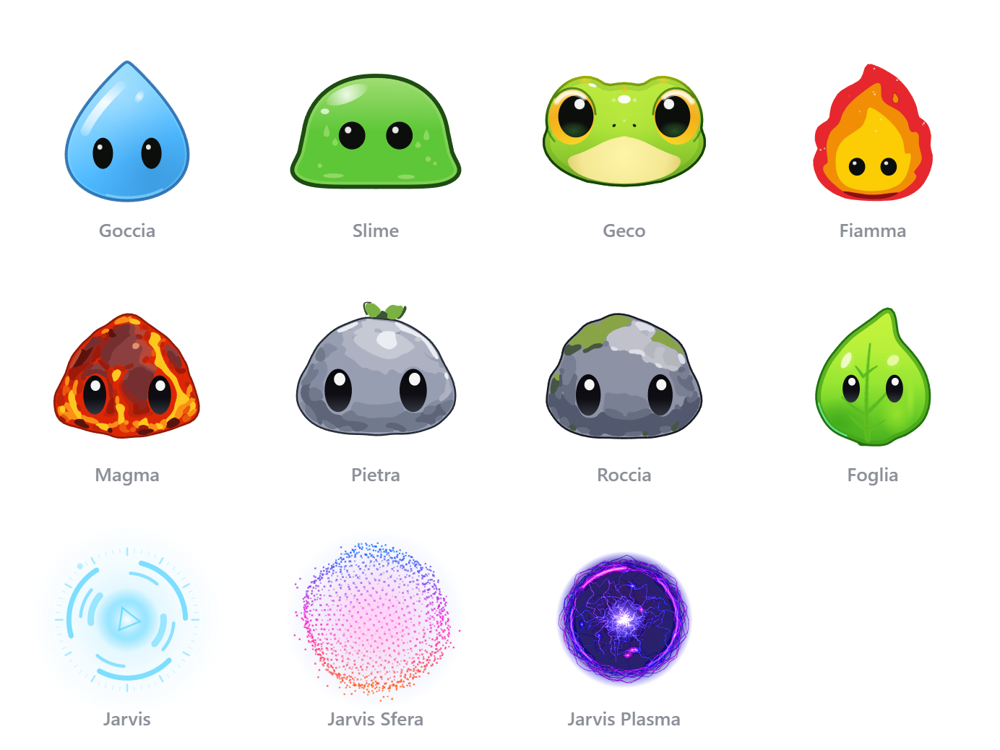
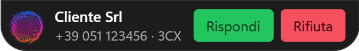
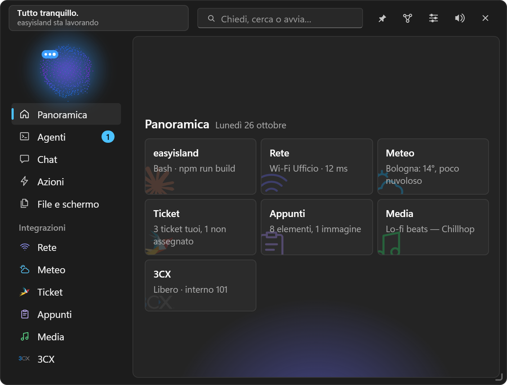
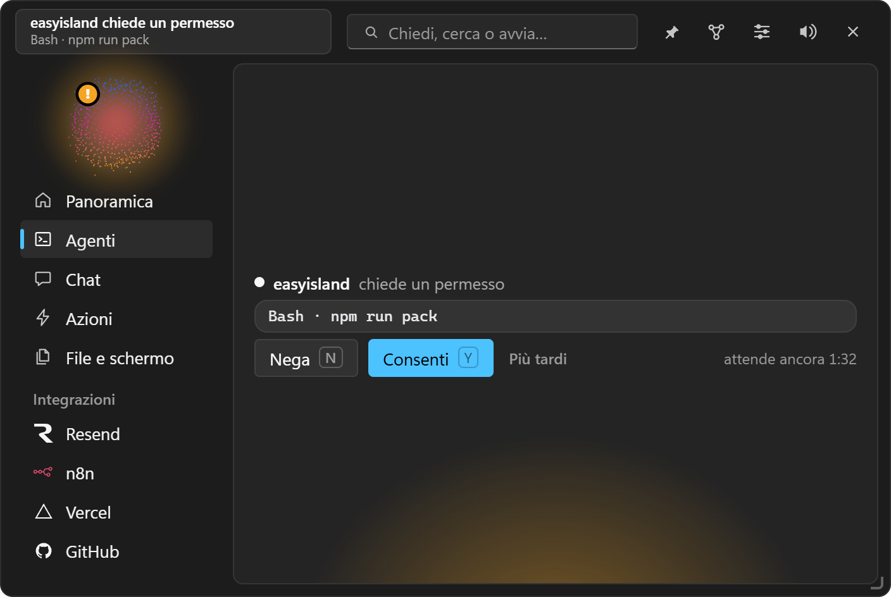
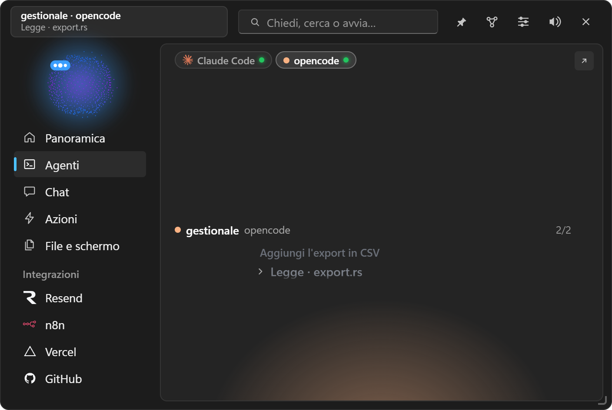
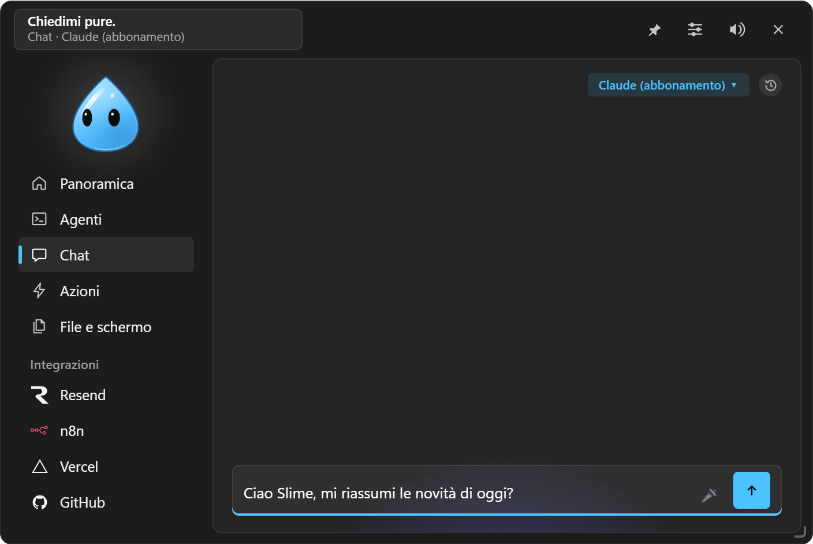
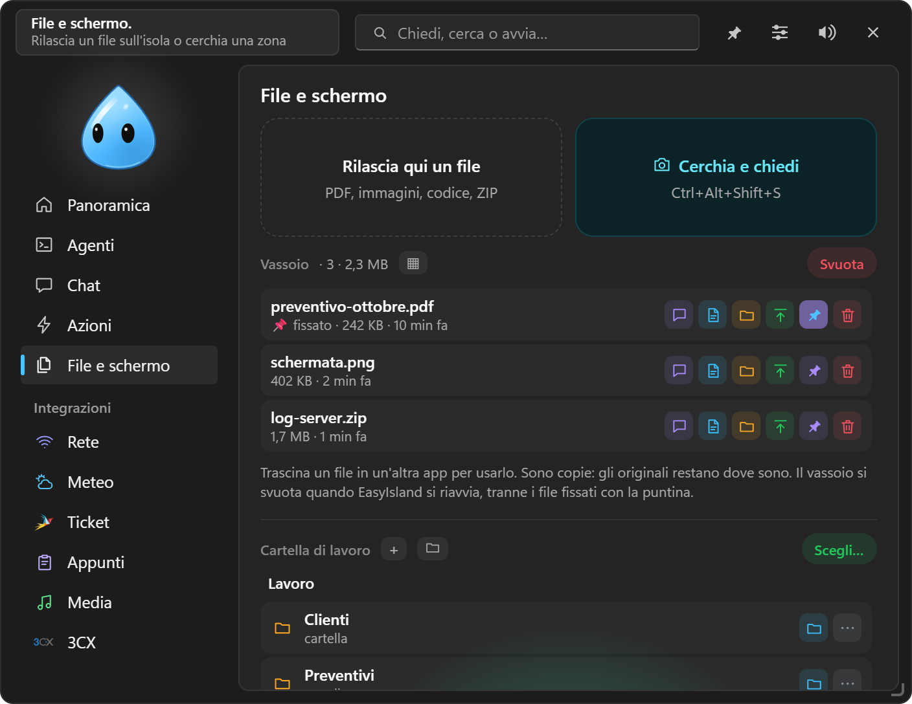

<div align="center">


# EasyIsland

**An island always within reach on your Windows screen, with a small animated character keeping an eye on Claude Code, your services and your PC.**

Approve Claude Code's permissions, watch the session work, drop a file, chat with Claude, keep an eye on your services: all without interrupting what you are doing.


[Italiano](README.md) · **English**

</div>


## What it does

- **Claude Code in the island**: watch sessions work, answer permissions with
  **Deny / Allow / Always** and questions, see **file changes** live, jump back to
  the session's app with one click; also **Codex**, **opencode**, Google's **Antigravity**, **Gemini CLI**
  and Claude Code in **Cursor**'s terminal; a **weekly recap** of the agents and
  the Pro/Max **plan limits** ([Claude Code](#claude-code)).
- **Chat** from the island with Claude (subscription or API key), **opencode**, **Antigravity**, **OpenRouter**,
  **OpenAI**, **Gemini** or local models with **Ollama** and **LM Studio**; attach
  text, files, copied images or a **screen area**; formatted answers (lists,
  tables, code with **Copy**); a calculator in the field; a **history** of
  conversations to reopen ([Chat with Claude](#chat-with-claude)).
- **Quick actions** (links, programs, scripts, questions to Claude) with global
  shortcuts, and suggestions for the app you are using
  ([Quick actions](#quick-actions-and-shortcuts)).
- **Integrations** in the island's menu: 3CX (calls, phone book, incoming calls),
  Microsoft Teams, Zammad, Outlook, PC status, security, network, weather,
  clipboard with text and images, media, recording, GitHub, Vercel, Stripe, n8n,
  Notion, Remote Desktop Manager and more ([Integrations](#integrations));
  **widgets** for websites, certificates, servers, domains, calendars and APIs
  ([Widgets](#widgets)).
- **Automations** "when… then…", created in Settings or in plain words in the
  chat, and suggested from your habits; Claude can also use the PC for you, with
  your consent ([Automations](#automations)).
- **Dropped files**: questions about a file, ZIP extraction, a tray of uploaded
  files.
- **Profiles** (work, home, focus) that switch by themselves, a **"customer is
  watching"** mode, messages from any script, settings backup.
- **Several characters** (Goccia, the default, Slime, Gecko, Flame, Magma, Stone,
  Rock and Leaf), free placement, an island as big as the screen opening where
  you want, themes, sounds generated in code, interface in **Italian or
  English**; light on battery, no telemetry.

<p align="center">

</p>

## What's new

**0.9.4** — **Faster chat**: Claude Code stays on between the messages of a conversation;
Notion rows come as a compact table with categories by name and totals already worked out; the
chat learns **recipes** as it is used and goes straight to the right tools on similar questions
(Settings → Chat → Recipes). While it works it also shows its reasoning, in the island and on
Telegram. "How much did I spend in October": from 29 to 12 seconds.

**0.9.3** — **Notion for every engine**: the chat reads and adds rows through EasyIsland's own
connection, which checks the values before writing (no more empty pages). **EasyIsland's tools**
reach **Antigravity** and **Claude with an API key** too. **⇄ Second opinion**: another engine
reviews the last answer, in the island and on Telegram. **/oggi** and **/domani** on Telegram:
the day at a glance.

**0.9.2** — **Stop** in the chat and on Telegram (■ instead of Send, ⏹ Stop and /stop): the
answer stops and the engine is closed. **Notion map for the chat**: your Notion's structure stays
on the PC, encrypted, so the chat no longer searches for it in every conversation.

**0.9.1** — **Remote Desktop Manager with Devolutions Hub**: the list also reads the user
vault (it used to stay empty) and opens the connection in its vault. The list stays on this
PC, encrypted for your Windows user, and updates only with **Sync**: RDM need not run when
you don't need it; a dot shows whether it is open.

**0.9.0** — Google's **Antigravity** like Claude Code and opencode: its sessions (the
`agy` CLI, IDE and app) in the island with steps, diffs and **Allow / Deny** on commands
and MCP tools, and as a **chat engine** with its own tools, from Telegram too; the
setup steps are in the settings.

**0.8.9** — **Mini Notion** in the Notion tab: your chosen pages, shown as tiles, open
in the island looking as in Notion (headings, lists, checkboxes, toggles, callouts, code,
images) and are edited there, with "/" for block types; databases as Table, Board (drag
the cards), List and Gallery, linked views included. **Telegram voice messages**
transcribed with Gemini, OpenAI or OpenRouter, with their own audio model.
**Telegram "Automatica"** (asks only before deleting), **settings the agents can change**,
**"Permissions and calls"** that can leave the island closed, clearer chat and agent settings.

**0.8.8** — **Telegram**: EasyIsland's chat in your own bot (made with @BotFather),
linked once with a code and to your chat only. Pick engine and model from there
(`/motore`, `/modello`); in terminal mode Allow / Deny arrive as buttons; photos and
files go to the Tray, and files the chat puts in the Tray reach you on Telegram
(`/vassoio`). **Work folder**: a folder of the PC in "Files and screen", with
subfolders, Rename, Move, To the Tray, Recycle Bin and dragging out; Tray files move
into it; the chat reads it and moves files into it, Telegram opens it with `/cartella`.
**opencode** now has EasyIsland's tools like Claude (Tray, apps, notices, quick actions,
automations).

**0.8.7** — **Record**: a conversation (microphone and PC audio) or the screen with
audio, or a **single window** picked from a list or by dropping the character on it,
with Windows only; a red dot with Stop next to the character, and at the end *To the
tray*, *Open*, *Show in folder*. In the search bar, **Search with Google**
(`Alt+Enter`). **Teams** and **Remote Desktop Manager** logos, the coloured glow at the
bottom of every tab, and clicking a tab while typing in the search bar closes and
clears it. With **⚡ Automatic** in the chat, opencode now uses connector tools (Notion
and others) without asking, except those that delete or send something. English
documentation: this README and [docs/en/](docs/en/).

**0.8.6** — **Microsoft Teams**: a meeting in progress recognised from microphone and
webcam, Microphone, Video, Raise hand, Share and Leave in the card and next to the
closed character, "Join from the copied link", automations when a meeting starts and
ends. **Microsoft account (API)**, to be tested: once signed in, Outlook reads mail and
calendar from Microsoft 365 (new Outlook too) and Teams shows presence and meetings
with "Join". A fully customisable **bar for the app in use**: only your actions,
**Keys** actions (shortcuts and text in the current program), questions about all the
text in the window, icon only or text only, "Bar only".

**0.8.5** — **Bar for the app in use** next to the closed character, like a Touch Bar:
your quick actions tied to the program you are using and the ⚡ suggestions for
Outlook, Excel, Word and the browser. A **right-click menu** in the island instead of
the browser's. **Overview** with large, faded logos in the corner of each tile.

| Version | Date | What's new |
|---|---|---|
| **0.9.4** | 20 Oct 2026 | Faster chat: Claude Code kept on, compact Notion with totals, recipes, visible reasoning |
| 0.9.3 | 19 Oct 2026 | Notion for every engine, tools in Antigravity and Claude API, Second opinion, /oggi and /domani |
| 0.9.2 | 19 Oct 2026 | Stop in the chat and on Telegram, Notion map for the chat |
| 0.9.1 | 18 Oct 2026 | Remote Desktop Manager with the Hub: user vault, encrypted offline list, Sync |
| 0.9.0 | 18 Oct 2026 | Google's Antigravity: sessions in the island with Allow / Deny and a chat engine, with setup steps |
| 0.8.9 | 18 Oct 2026 | Mini Notion in the tab (pages and databases viewed and edited in the island), Telegram voice messages, Telegram "Automatica", settings from the agents, "Permissions and calls" |
| 0.8.8 | 17 Oct 2026 | Telegram (chat, engine and model from there, Allow / Deny, files both ways), work folder in "Files and screen", the chat and Telegram, EasyIsland's tools for opencode too |
| 0.8.7 | 17 Oct 2026 | Record (conversation, screen or one window), Search with Google, Teams and RDM logos, glow in every tab, search closing on tab click, ⚡ Automatic with connector tools, English documentation |
| 0.8.6 | 16 Oct 2026 | Microsoft Teams (meetings, controls, Join), Microsoft account with the APIs for Outlook and Teams (to be tested), customisable app bar with Keys actions |
| 0.8.5 | 16 Oct 2026 | App bar next to the closed character, right-click menu in the island, Overview with large logos |
| 0.8.4 | 15 Oct 2026 | Automations with new events, filters, more conditions, repeats and event data in the steps; Settings above the island; Notion with views and alerts; Remote Desktop Manager (beta); grouped Integrations |
| 0.8.3 | 15 Oct 2026 | Terminal mode in the chat for every engine, ⚡ Automatic, Notion with tasks, notes and pinned pages, connectors from Claude Code plugins |
| 0.8.2 | 14 Oct 2026 | Replace keeping the original formatting (or not), tray after Circle and ask, Media instead of Music |
| 0.8.1 | 14 Oct 2026 | Network: adapter chosen with buttons, a ping for each adapter's gateway |
| 0.8.0 | 14 Oct 2026 | New logo, Network with every adapter, continuous ping and adapter settings, album art in Music, Settings in a window, 3CX phone book, Claude Code sign-in renewal for plan limits |
| 0.7.9 | 14 Oct 2026 | Suggestions at the right moment (downloads, copied errors, dev servers, secrets removed from the clipboard), daily recap, EasyIsland tools in Claude Code |
| 0.7.8 | 13 Oct 2026 | New island with a menu on the left and an Overview, quick answers with the island closed, animated weather card |
| 0.7.7 | 13 Oct 2026 | Circle and ask with OCR, character visible during 3CX calls, default ringtone, integration colours |
| 0.7.0–0.7.6 | 11–13 Oct 2026 | New and redrawn characters, 3CX softphone, team, chat and voicemail, a window as chat context, plan limits from Anthropic |
| 0.6.x | 8–11 Oct 2026 | Selected-text menu with preview, chat history, opencode 2, English interface, `Ctrl+Space`, weekly recap |
| 0.5.x | 4–7 Oct 2026 | 3CX, tray, more chat engines and agents, live file changes, habit-based automation suggestions |
| 0.3.0 | 4 Oct 2026 | Automations, Claude using the PC from the chat, calculator, ZIP |
| 0.2.0 | 2 Oct 2026 | First public release, automatic updates |

The full history, in Italian, is in the [Italian README](README.md#novità).

---

## Installation

**The easiest way:** download `EasyIsland-Windows-X.Y.Z-setup.exe` from the
[latest release](https://github.com/EdoardoDevelop/easyisland/releases/latest) and
run it. It installs for the current user only: no administrator prompt. The
installer is not code-signed yet, so Windows SmartScreen shows a warning: click
**More info → Run anyway**. Then see [After installing](#after-installing). Later
updates arrive by themselves (see [Updating](#updating)).

**Or build it on your PC** with steps 1–4 below: you get the same `.exe`
installer. The first time takes about 15–20 minutes (mostly downloads and
compiling), a few minutes afterwards.

### 1. Tools (first time only)

Open **PowerShell** and install the four tools with `winget`, already part of
Windows 10/11:

```powershell
winget install --id Git.Git -e
winget install --id OpenJS.NodeJS.LTS -e
winget install --id Rustlang.Rustup -e
winget install --id Microsoft.VisualStudio.2022.BuildTools -e --override "--wait --passive --add Microsoft.VisualStudio.Workload.VCTools --includeRecommended"
```

| Tool | What it is for |
|---|---|
| Git | downloading the project |
| Node.js (LTS, 20 or newer) | building the interface |
| Rust (rustup) | building the app and the `easyisland-hook.exe` relay |
| Visual Studio Build Tools, "Desktop development with C++" workload | the linker and Windows libraries Rust uses |

The last command downloads a few GB and can take a while. WebView2, which draws the
interface, is already part of Windows 10/11.

**Close and reopen PowerShell** afterwards so the new commands (`git`, `npm`,
`cargo`) are found. To check:

```powershell
git --version; node --version; cargo --version
```

### 2. Get the project

```powershell
cd $HOME
git clone https://github.com/EdoardoDevelop/easyisland.git
cd easyisland
```

### 3. Build the installer

```powershell
npm install
npm run pack
```

`npm run pack` builds the relay, the interface and the app, and leaves two files
in `release\`:

```
EasyIsland-Windows-X.Y.Z-setup.exe    the installer with its version
EasyIsland-Windows-setup.exe          the same file with a fixed name
```

### 4. Install

```powershell
start .\release\EasyIsland-Windows-setup.exe
```

### After installing

EasyIsland starts and the character greets you; from then on it is in the Start
menu and in the notification area. From the EasyIsland icon in the notification
area → **Settings…**:

1. **Agents → Claude Code → Install…** to see your sessions in the island (see
   below). It also works with the Claude desktop app.
2. **Chat**: choose the engine. "Claude (subscription)" uses your Pro or Max plan
   but **needs the Claude Code command line** installed and signed in (see
   [Chat with Claude](#chat-with-claude)); otherwise choose an API key or another
   engine.
3. **Position and look**: the corner and the icon you prefer.

### Updating

**Automatically:** at startup and then once a day EasyIsland checks GitHub for a
newer release. If there is one, the island shows **Update available** with
**Install** / **Later**: nothing is installed without your click. The update is
signed and the app verifies the signature before running it; it then closes and
reopens by itself. You can check by hand, or turn the check off, in **Settings →
General → Updates**.

**If you built it yourself:**

```powershell
cd $HOME\easyisland
git pull
npm install
npm run pack
start .\release\EasyIsland-Windows-setup.exe
```

The installer replaces the previous version; settings and keys are kept.

### Uninstalling

First, in **Settings… → Agents**, click **Uninstall…** on the Claude Code row: the
uninstaller deliberately does not touch Claude Code's `settings.json`. Then
**Windows Settings → Apps → Installed apps → EasyIsland → Uninstall**.

### Troubleshooting

| Problem | Fix |
|---|---|
| `npm`, `cargo` or `git` "not recognized" | close and reopen PowerShell after installing the tools |
| `linker 'link.exe' not found` | the Visual Studio Build Tools with the C++ workload are missing: run the last `winget` command of step 1 again |
| `error: toolchain 'stable-x86_64-pc-windows-msvc' is not installed` | `rustup default stable-msvc` |
| Defender blocks the installer | it is the false positive described above: use "Run anyway", or start `target\release\easyisland.exe` directly |
| The character does not appear | look in the notification area (the ^ arrow next to the clock) and in the log, `%LOCALAPPDATA%\EasyIsland\easyisland.log` |
| A key or password "does not save" | Windows Credential Manager is full (often hundreds of cached tokens from other apps) and refuses new entries; Settings says so under the field. Delete the entries you don't need from Control Panel → Credential Manager → Generic credentials and try again |
| Open Settings without the notification area | `"%LOCALAPPDATA%\EasyIsland\easyisland.exe" --settings` (also as a shortcut) |

## How to use it









_Screenshots are generated from the preview with `node scripts/screenshots.mjs` (with `npm run dev` running), using the test data of the scenes in `dev/scenes.ts`. They show the Italian interface._

| You do | What happens |
|---|---|
| Move the mouse over the character (top centre, or the corner you chose) | It grows (or stays that way with **Always visible**), hops, looks at you and waves |
| Click the character, or rest the mouse on it if "Open after" allows it | The island opens, aligned to that side |
| Drag the character with the left button (the resting icon too) | It moves where you drop it, even to another screen, and the position is saved in the profile |
| Drag the bottom corner of the open island | Changes the island's width and height, up to the screen edges. Double-click the corner: default size |
| The **menu on the left** of the open island | The character on top, then **Overview**, **Agents**, **Chat**, **Actions**, **Files and screen** and your integrations, each with its logo (or an emoji) and a dot when there is news. At the top, the character tells you in a speech bubble what is happening |
| **Overview** | Every integration and agent as a tile with its status; a click opens one, dragging reorders them |
| **Agents** | The coding agent's session (Claude Code, Codex…): progress, changes, permissions |
| In the chat, drag the character onto another app's window | That window becomes the chat's context: an image of it, with the app's name and title, goes with your question |
| Drag a file onto the island | The character becomes a box, swallows it and offers to answer questions about the file |
| The clock at the top of the chat | The **history**: earlier conversations, with date and engine; a click reopens one |
| `Esc`, or the ✕ at the top right | Closes the island at once |
| 📌 at the top right | **Keep open**: the island no longer closes by itself, and becomes a normal window with a taskbar icon |
| Type a calculation in the chat, e.g. `840 + 22%` | The result appears at once; **Enter** copies it, **Ctrl+Enter** asks the chat anyway. Calculated locally |
| Drop a ZIP | Besides "Ask a question" there is **Extract…** |
| **Files and screen** → **Circle and ask** (or `Ctrl+Alt+Shift+S`) | The screen freezes: circle an area and ask about it, run your quick actions, copy the image or its **text** (recognised by Windows), or keep it in the tray |
| **Files and screen** → **Record** | Records a conversation (microphone and PC audio), the screen or a single window, with Windows only |
| Type in the **field at the top** of the open island | Finds integrations, agent sessions, ⚡ actions and installed programs; at the bottom **Ask the chat** and **Search with Google**. Arrows to choose, **Enter** to open, **Ctrl+Enter** to ask the chat, **Alt+Enter** to search the web, **Esc** to clear |
| Notification area icon | Open, Settings…, Pause, Quit |

Everything else happens by itself: a Claude Code permission request opens the
island with **Deny / Allow** (and **Always** when Claude Code proposes a rule to
remember), a finished session shows Claude's last message, and your integrations
sit in the menu on the left.

**Live changes:** while Claude Code works, every file it changes shows up in the
steps with lines added in green and removed in red (`+12 −3`). A click opens the
**Changes** tab: one tab per file, each change with 3 lines of context and line
numbers, ↗ to open the file in VS Code at that line. The diff comes from the data
Claude Code passes to the hook, without reading the file, and stays in memory only.

## Position and look

**Settings… → Position and look** decides where the character lives and how much
it shows:

- **Position**: top or bottom, left, centre or right; or **drag the character**
  anywhere. The open island can be moved by its header and slides back when
  closed.
- **Screen**: primary, the one under the cursor, or the one you dragged it to.
- **The island opens**: where the character is, or always at the top centre, the
  centre of the screen or the bottom centre.
- **Width** and **Minimum height** of the open island, up to the screen edges.
- **Over the taskbar**, **Snap to edges**, **Compact view** (larger animated
  character or a compact bar), **Quick answers** next to the closed character
  (permissions and 3CX calls without opening the island), **Follows the mouse**,
  **Always visible**, **Resting icon**, **Open after**, **Close button**,
  **Full screen** (hides during videos, games and presentations; permission
  requests still show).

To try combinations without building the app (Node only, no Rust):

```powershell
npm install
npm run ui
```

The browser opens on a fake desktop; settings go in the address, e.g.
`http://localhost:1420/?anchorV=bottom&anchorH=left&iconStyle=dot&iconSize=32`.

## Quick actions and shortcuts

**Settings… → Quick actions** creates the buttons of the island's ⚡ tab:

| Type | What it does |
|---|---|
| **Ask the chat** | sends a saved prompt, applied to the copied text or to the file dropped on the island |
| **Script** | runs PowerShell or Command Prompt commands, hidden, and shows the output in the island. It runs **only after a click**; with "Ask for confirmation" it shows the commands first |
| **Program / folder** | starts a program with its arguments (e.g. `mstsc /v:server01`) or opens a folder |
| **Link** | opens an address in the browser |
| **Keys** | sends shortcuts or text to the program in use |

Actions can be grouped in **folders**, reordered and given an icon drawn in code.
**Suggestions for the app in use** appear at the top of the ⚡ tab (summarise a mail,
explain data in Excel, fix text in Word, translate a web page…).

**Global shortcuts**, valid in every app (customisable):

- `Ctrl+Space` opens the island on the actions (or the chat);
- `Ctrl+Alt+K` opens the chat with the copied text (or image) attached;
- `Ctrl+Alt+H` opens the **Clipboard** history;
- `Ctrl+Alt+Shift+S` **circle and ask**;
- `Ctrl+Alt+Shift+P` goes to the **pending request**: `N` denies, `Y` allows,
  `S` always, `1`–`9` picks an answer;
- `Ctrl+Alt+Shift+T` brings the **session's app** forward;
- `Win+Alt+A` shows your actions on the **selected text** in any app, with a
  before/after preview for the ones that replace it;
- every action can have its own shortcut.

## Integrations

**Settings… → Integrations** turns on the integrations, one per type, shown in the
island's menu and in the **Overview** tiles. Keys, tokens and addresses are kept in
Windows Credential Manager.

| Integration | What it shows |
|---|---|
| **GitHub, Vercel, Stripe, Resend, Notion, Cal.com, n8n** | the service's activity (deploys, payments, emails, bookings, runs), with the service's key; Notion also with tasks, quick notes, pinned pages and search |
| **Zammad** | tickets assigned to you, unassigned and escalated; alerts on a new ticket |
| **Telegram** | EasyIsland's chat in your own Telegram bot (token from @BotFather, linked with a code valid 10 minutes, then for good and to your chat only). A separate conversation with engine and model picked there (`/motore`, `/modello`, `/nuova`, `/stato`); Allow / Deny as buttons; photos and files to the Tray; the chat's files sent back; `/vassoio` and `/cartella`. Only while the PC is on: messages sent while EasyIsland is closed are dropped |
| **Outlook** | unread mail and today's and tomorrow's appointments from classic Outlook; with a Microsoft account, from Microsoft 365 too |
| **Microsoft Teams** | a meeting in progress, with microphone, video, raise hand, share and leave; presence and meetings with a Microsoft account |
| **Remote Desktop Manager** | your connections, searchable from the island's search bar |
| **PC status** | disk space, memory, battery, uptime, pending restart; **Copy PC info** for a ticket |
| **Security** | antivirus, signature age, last scan, firewall, threats |
| **Network** | Wi-Fi or cable, local and public IP, gateways and DNS, every adapter, VPNs, latency, a continuous ping and **Edit network…** |
| **Weather** | a city's weather (Open-Meteo, free, no key): the sky now, animated, the next 12 hours and 7 days |
| **Clipboard** | the last 30 texts and images copied, plus pinned ones: paste, copy, transform, **Ask the chat**. Memory only, never on disk |
| **Media** | what is playing in any app that shows up in Windows media controls, with artwork and controls |
| **Record** | a conversation, the screen or a window, saved as `.m4a` or `.mp4` |
| **3CX** | the 3CX V20 phone system: call, phone book, incoming calls with **Answer** / **Decline**, team, chat, voicemail, queues; or EasyIsland as the phone itself ("This PC") |

Each integration shows its logo (or a dot) or an emoji in the menu, and has a
**colour** the character wears while its tab is open. Integrations are reordered by
dragging them; which ones are on depends on the profile.

## Widgets

**Settings… → Widgets** adds repeatable checks, as many as you need, with no code:
**Calendar** (ICS link), **Domain expiry**, **Website**, **HTTPS certificate**,
**Ping**, **TCP port**, **Windows service**, **JSON API** (fields to show and an
alert rule). When a check goes from OK to a problem, its menu entry gets a dot, the
character makes a sound and the island shows itself, following the profile's
notification rules.

## Customer is watching

**Settings… → Notifications → Customer is watching**: the character steps aside
when someone might see your screen — during calls (microphone or webcam in use by
any app), during remote assistance, or by hand from the notification area. It hides
the character and mutes sounds (Claude Code permission requests still show), or
only mutes.

## Messages from scripts

Any script, scheduled task, n8n flow or program can show a message on the island:

```powershell
& "$env:LOCALAPPDATA\EasyIsland\bin\easyisland-hook.exe" notify "Backup" "Done in 4 minutes" --stato ok
```

`--stato` is `ok`, `avviso` (warning), `errore` (error) or `info`; `--apri https://…`
adds a button with a link; `--help` shows the help. It exits with 0 if the message
arrived and 2 if EasyIsland is not running, so a script never hangs.

## Profiles, theme and backup

- **Language** (Settings → General): like Windows, Italian or English. The chat
  answers in the same language.
- **Profiles** (*Work*, *Home* and *Focus* to start with) each have their own
  integrations, position, look, sounds, theme and notification rules, and can
  switch by themselves by Wi-Fi network, days and time.
- **Theme**: the character and its colour, the island's colour and opacity,
  separate volumes for alerts, interface and emotions.
- **Backup**: *Export…* saves every setting to a JSON file; *Import…* loads it on
  another PC. API keys are never in the file.

## Claude Code

Open **Settings… → Agents** and click **Install…** on the Claude Code row. You see
the exact diff of what will change in `%USERPROFILE%\.claude\settings.json` and the
path of the dated backup. Nothing is written until you click. Your own hooks are
never touched, and uninstalling removes only EasyIsland's entries.

The relay is a small executable, `easyisland-hook.exe`, copied to
`%LOCALAPPDATA%\EasyIsland\bin\` at startup. It has 300 ms to reach EasyIsland and
exits cleanly if the app is closed, slow or has crashed: **a Claude Code session is
never blocked or slowed down by EasyIsland.** If nobody answers a permission request
in time, Claude Code asks in the terminal as usual.

**Weekly recap** on Mondays (hours at work, sessions, files and lines changed,
commands, permissions: counts only, never commands or content) and **plan limits**
(Pro and Max: 5 hours, week and Opus week, with an alert from 80 %).

**Codex, opencode, Antigravity and Gemini CLI** are installed from the same page with the same
rules (diff, dated backup, confirmation). Codex, opencode and Antigravity permission requests
arrive in the island with **Allow / Deny**; Gemini only shows that it is waiting.
Google's **Antigravity** is also a **chat engine**: install its CLI with
`irm https://antigravity.google/cli/install.ps1 | iex`, run `agy` to sign in with Google,
and install its hooks for Allow / Deny on the chat's commands.
Any other tool can appear in **Agents** by sending events to
`easyisland-hook <Event>` with an `easyisland_agent` field.

## Chat with Claude

**Work folder.** In **"Files and screen"** or **Settings… → Chat**, "Choose…" points to a
folder of the PC. In "Files and screen" you browse it under the Tray (double click to
enter a folder or open a file) and with "⋯" rename, move, copy to the Tray, copy the
path or send to the Recycle Bin; the Tray's green icon moves a file there. The chat
(with EasyIsland's tools) reads it without asking and moves Tray files into it; in
terminal mode it is the folder the chat works in. From Telegram: `/cartella`.

**Settings… → Chat** picks the **default** engine; the model name at the top right of
the chat picks another one for that conversation only:

- **Claude subscription (through Claude Code)**, the default: uses Claude Code on the
  PC (`claude -p`, hidden) and your Pro or Max plan. **It needs the Claude Code
  command line, signed in** — the desktop app alone is not enough. To install it:
  `irm https://claude.ai/install.ps1 | iex`, then run `claude` and sign in, then
  **Check again** in Settings → Chat.
- **Anthropic API key**, **OpenRouter**, **OpenAI** and **Gemini**: the key goes to
  Credential Manager, the model is picked from the list.
- **Ollama** and **LM Studio**: models on your PC or network, no key.
- **opencode** (opencode 2): free, local or connected models, **with tools**. Every
  command, edit or web access asks **Allow / Deny** in the island.

**Terminal mode** (Settings → Chat) lets the chat run commands, edit files and use
your MCP servers, plugins and skills in a folder you choose, with Allow / Deny for
each step. **⚡ Automatic** lets ordinary operations through for one conversation:
file edits, web access, commands that are not delicate and connector tools; deleting,
publishing, installing, changing the system, sending messages and folders outside the
working one still ask.

**Connectors**: the chat can use the MCP servers you configured in Claude Code,
chosen per profile, with "ask for confirmation" on by default.

Keys are kept in **Windows Credential Manager**, never on disk and never in the
interface. The chat **history** (up to 100 conversations) stays on this PC only.

No telemetry. EasyIsland's network requests go to the services you configure, plus
one more: the update check, which reads a release file on GitHub and can be turned
off.

## Automations

**Settings… → Automations**: when something happens, EasyIsland does something for
you — at a time, at startup, on unlock, on a Wi-Fi network, when a program starts,
when a USB drive is plugged in, when a file arrives in a folder, when an
integration or widget reports a problem, when a download finishes, on a 3CX call, when
an agent finishes or waits, when a Teams meeting starts or ends… with filters,
conditions and limits ("at most every N minutes"). **Then** is a sequence of steps:
a quick action, an alert, a profile switch, opening a program, folder or link,
asking the chat.

You can also **ask Claude in plain words** in the chat ("every weekday at 9 open
Outlook"): the island shows the automation with **Allow / Deny** before creating it.

**Suggestions from your habits** (off by default) note when you open programs
(names only), turn on or unlock the PC, Wi-Fi networks and USB drives, locally and
for at most 45 days, and suggest automations at most once a day.

**Claude can use the PC**: with the subscription, the chat can open programs,
folders and links, run your **quick actions**, read the status of PC, network,
weather, mail and tickets, use the clipboard and media, show an alert and switch
profile. Anything that opens, runs or changes something asks **Allow / Deny** first.
Claude cannot run arbitrary commands, send email or delete.

## Building it yourself

For people working on the code. The tools are those of step 1 of
[Installation](#installation).

```powershell
npm install
npm run tauri dev      # the real app, with live reload of the interface
npm run ui             # the interface only, in the browser (no Rust needed)
npm run build          # type check + interface build
npm run pack           # builds the installer into release/
```

Sounds, icons and characters are all generated in code: no audio or image files.
See [docs/en/development.md](docs/en/development.md) for tests, previews and
releases, and [docs/en/architecture.md](docs/en/architecture.md) for the layout of
the code.

### Structure

```
./
  src/                 island front end (TypeScript, no framework)
    character/         the characters and the greeting, in Canvas 2D
    island/            state machine, hooks, integrations
    views/             every view of the island
    settings/          the settings window
  src-tauri/           Rust backend: window, named pipe, Claude APIs, integrations, 3CX, automations
  hook/                easyisland-hook.exe: the relay for the agents and the "easyisland" MCP connector
  scripts/             icons, installer packaging, README screenshots
  dev/                 browser previews (characters, sounds, drop) and screenshot scenes
  screenshots/         the images of this README
  docs/                project notes (Italian); English versions in docs/en/
```

### Log

`%LOCALAPPDATA%\EasyIsland\easyisland.log`: hook events, permission decisions,
poller problems. It stays on your computer.

## Origin

EasyIsland started as a Windows-only fork of
[Louis-CFM/coucou](https://github.com/Louis-CFM/coucou) (Coucou, with the Mochi
character), a native macOS notch app. Slime took Mochi's place. The macOS code and
the original prototype were removed (they remain in git history).

License: MIT for the code. EasyIsland's names, characters, icons and sounds are new;
those of the original (no longer used) remain reserved to its author: see
`LICENSE-ASSETS.md`.
